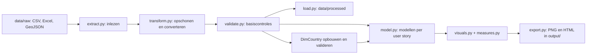

# ICTD-B Data Engineering 2026-27 P1 

Python-project voor het verwerken en analyseren van Contoso-verkoopgegevens en weerdata. De pipeline leest CSV-, Excel- en GeoJSON-bestanden in en bouwt vervolgens per user story een specifiek gegevensmodel op. Iedere visualisatielibrary heeft zijn eigen exportfunctie. Vanuit `main.py` worden alle afzonderlijke onderdelen aangeroepen en samengebracht tot een bruikbaar resultaat.

Het project sluit aan op een ontwerp met Power BI en een Galaxy Schema met Snowflake-uitsplitsingen. Deze repository bevat de Python-uitwerking met pandas en visualisaties in PNG- en HTML-formaat. 

## Inhoud

- [Architectuur](#architectuur)
- [Projectstructuur](#projectstructuur)
- [Installeren](#installeren)
- [Brondata toevoegen](#brondata-toevoegen)
- [Pipeline draaien](#pipeline-draaien)
- [Datamodel](#datamodel)
- [Analyses en visualisaties](#analyses-en-visualisaties)
- [Validatie en probleemoplossing](#validatie-en-probleemoplossing)
- [Ontwikkelafspraken](#ontwikkelafspraken)
- [Huidige beperkingen](#huidige-beperkingen)

## Architectuur

`main.py` voert de stappen achtereenvolgens uit. Verwerkte datasets blijven tijdens de uitvoering in een dictionary met pandas-DataFrames en worden daarnaast naar bestanden geschreven. De analysemodellen worden in het geheugen opgebouwd; er worden geen SQL-tabellen aangemaakt.



De verwerking omvat onder andere:

- De datumdimensie beperken tot 2011–2013 en `Date` afleiden uit `DateInt`.
- Datums en geldbedragen naar bruikbare datatypes omzetten.
- Sleutels controleren op ontbrekende en dubbele waarden.
- `DimCountry` opbouwen uit geografie en weerdata, met ISO3-landcodes via `pycountry`.
- Tabellen per user story koppelen met pandas-merges, meestal als left join.
- Omzet, kosten, winst, verkoopaantallen, retouren en temperatuur aggregeren.

## Projectstructuur

```text
.
├── main.py                 # Orkestratie van de volledige pipeline
├── requirements.txt        # Python-afhankelijkheden
├── src/
│   ├── config.py           # Relatieve bron- en uitvoerpaden
│   ├── extract.py          # CSV, Excel en GeoJSON lezen
│   ├── transform.py        # Opschonen en DimCountry opbouwen
│   ├── validate.py         # Asserties voor datakwaliteit
│   ├── load.py             # Verwerkte CSV en GeoJSON schrijven
│   ├── model.py            # Selecties, joins en aggregaties per user story
│   ├── measures.py         # Herbruikbare berekeningen
│   ├── visuals.py          # Figuren, interactieve grafieken en kaart
│   └── export.py           # Export naar PNG en HTML
├── data/                   # Lokaal toevoegen; inhoud uitgesloten van Git
│   ├── raw/                # Originele bronbestanden
│   └── processed/          # Gegenereerde datasets
├── output/                 # Rapporten; huidige bestanden staan in Git
└── docs/                   # Les- en achtergrondmateriaal
```

## Installeren

### Vereisten

- Git en Python met `pip` en `venv`.
- Python 3.12 is in de cloudomgeving getest; er is geen Python-versie vastgepind in de repository.
- De bronbestanden uit de volgende sectie.

### Linux / macOS

```bash
git clone https://github.com/gielvangaal/L3P1.git
cd L3P1
python3 -m venv .venv
source .venv/bin/activate
python -m pip install -r requirements.txt
mkdir -p data/raw data/processed
```

### Windows (PowerShell)

```powershell
git clone https://github.com/gielvangaal/L3P1.git
cd L3P1
py -m venv .venv
.\.venv\Scripts\Activate.ps1
python -m pip install -r requirements.txt
New-Item -ItemType Directory -Force data/raw, data/processed
```

Heb je de repository al uitgecheckt, begin dan bij het maken of activeren van de virtuele omgeving. Als PowerShell activering blokkeert, kun je de interpreter rechtstreeks gebruiken: `.\.venv\Scripts\python.exe -m pip install -r requirements.txt`.

De belangrijkste libraries zijn pandas, NumPy, pycountry, openpyxl, Matplotlib, Seaborn, Plotly, Altair, Folium, Shapely en Branca. Versies zijn momenteel niet vastgepind en er is geen lockfile.

## Brondata toevoegen

Plaats onderstaande bestanden met exact deze namen in `data/raw/`. De paden staan in [`src/config.py`](src/config.py). De data wordt niet automatisch gedownload en is niet meegeleverd in Git.

| Bronbestand | Verwerkte dataset in `data/processed/` |
| --- | --- |
| `Contoso_Calendar.csv` | `dim_date.csv` |
| `Contoso_Channel.csv` | `dim_channel.csv` |
| `Contoso_Daily_Weather_2011_2013_NIJE3.xlsx` | `fact_weather.csv` |
| `Contoso_Geography.csv` | `dim_geography.csv` |
| `Contoso_Product.csv` | `dim_product.csv` |
| `Contoso_Product_Category.csv` | `dim_product_category.csv` |
| `Contoso_ProductSubcategory.csv` | `dim_product_sub_category.csv` |
| `Contoso_Promotion.csv` | `dim_promotion.csv` |
| `Contoso_Sales.csv` | `fact_sales.csv` |
| `Contoso_Stores.csv` | `dim_store.csv` |
| `countries.geojson` | `countries.geojson` |

Daarnaast genereert de pipeline `dim_country.csv`: in totaal elf CSV-bestanden en één GeoJSON-bestand.

## Pipeline draaien

Voer vanuit de hoofdmap van de repository uit, met de virtuele omgeving actief:

```bash
python main.py
```

Een succesvolle uitvoering schrijft de verwerkte datasets naar `data/processed/` en tien rapporten naar `output/`.

**Let op:** opnieuw draaien overschrijft bestaande verwerkte datasets en gelijknamige rapporten. 

## Ontwikkelafspraken

- Houd ruwe brondata apart van verwerkte output; bewerk originele bestanden niet in de pipeline.
- Beheer bron- en uitvoerpaden centraal in `src/config.py`.
- Houd extractie, transformatie, validatie, modellering en presentatie in hun eigen modules.
- Gebruik de bestaande naamgeving: `transform_*`, `validate_*`, `model_ceo_*`, `model_fm_*` en `visual_*`.
- Behoud user-storycodes in rapportnamen, zodat analyse en uitvoer herleidbaar blijven.
- Controleer `git status` vóór een commit. De inhoud van `data/` wordt genegeerd; een lokale `.venv/` wordt door de huidige `.gitignore` niet uitgesloten. Commit geen virtuele omgeving of lokale caches.
- Voeg een nieuwe dependency toe aan `requirements.txt` en documenteer aanvullende invoer of uitvoer in deze README.

## Huidige beperkingen

- Het ontwerpdocument bevat o.a. de functionele en technische uiteenzetting van dit project.
- Validaties zijn basiscontroles: volledige schema-, foreign-key- en joincardinaliteitscontrole ontbreekt. Ongeldige numerieke waarden kunnen bij conversie `NaN` worden zonder dat dit overal wordt afgekeurd.
- De pipeline stopt bij een fout en kan dan al gedeeltelijke uitvoer hebben geschreven. 
- Er is geen transactionele verwerking, centrale logging of geïmplementeerde auditmetadata.
- Dit project is open source en beschikbaar onder de MIT-licentie. De licentie geldt voor de eigen broncode; externe datasets vallen onder de voorwaarden van hun oorspronkelijke aanbieders.