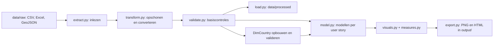
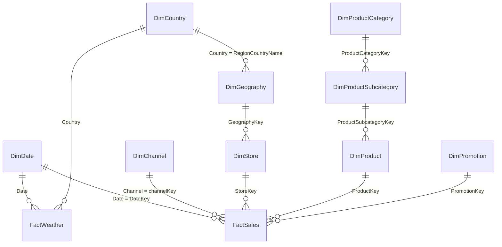

# L3P1 — Data Engineering met Contoso

Python-project voor het verwerken en analyseren van Contoso-verkoopgegevens en weerdata. De pipeline leest CSV-, Excel- en GeoJSON-bestanden, bouwt analysemodellen en exporteert tien visualisaties voor een CEO en een filiaalmanager.

Het project sluit aan op een ontwerp met Power BI en een galaxy-/snowflake-datamodel. Deze repository bevat de Python-uitwerking: verwerking in pandas en rapporten als PNG en HTML. Er is geen databaseserver, webapplicatie of dashboardserver nodig.

## Inhoud

- [Architectuur](#architectuur)
- [Projectstructuur](#projectstructuur)
- [Installeren](#installeren)
- [Brondata toevoegen](#brondata-toevoegen)
- [Pipeline draaien](#pipeline-draaien)
- [Datamodel](#datamodel)
- [Analyses en visualisaties](#analyses-en-visualisaties)
- [Validatie en probleemoplossing](#validatie-en-probleemoplossing)
- [Ontwikkelafspraken](#ontwikkelafspraken)
- [Huidige beperkingen](#huidige-beperkingen)

## Architectuur

`main.py` voert de stappen achtereenvolgens uit. Verwerkte datasets blijven tijdens de uitvoering in een dictionary met pandas-DataFrames en worden daarnaast naar bestanden geschreven. De analysemodellen worden in het geheugen opgebouwd; er worden geen SQL-tabellen aangemaakt.



De verwerking omvat onder andere:

- De datumdimensie beperken tot 2011–2013 en `Date` afleiden uit `DateInt`.
- Datums en geldbedragen naar bruikbare datatypes omzetten.
- Sleutels controleren op ontbrekende en dubbele waarden.
- `DimCountry` opbouwen uit geografie en weerdata, met ISO3-landcodes via `pycountry`.
- Tabellen per user story koppelen met pandas-merges, meestal als left join.
- Omzet, kosten, winst, verkoopaantallen, retouren en temperatuur aggregeren.

## Projectstructuur

```text
.
├── main.py                 # Orkestratie van de volledige pipeline
├── requirements.txt        # Python-afhankelijkheden
├── src/
│   ├── config.py           # Relatieve bron- en uitvoerpaden
│   ├── extract.py          # CSV, Excel en GeoJSON lezen
│   ├── transform.py        # Opschonen en DimCountry opbouwen
│   ├── validate.py         # Asserties voor datakwaliteit
│   ├── load.py             # Verwerkte CSV en GeoJSON schrijven
│   ├── model.py            # Selecties, joins en aggregaties per user story
│   ├── measures.py         # Herbruikbare berekeningen
│   ├── visuals.py          # Figuren, interactieve grafieken en kaart
│   └── export.py           # Export naar PNG en HTML
├── data/                   # Lokaal toevoegen; inhoud uitgesloten van Git
│   ├── raw/                # Originele bronbestanden
│   └── processed/          # Gegenereerde datasets
├── output/                 # Rapporten; huidige bestanden staan in Git
└── docs/                   # Les- en achtergrondmateriaal
```

## Installeren

### Vereisten

- Git en Python met `pip` en `venv`.
- Python 3.12 is in de cloudomgeving getest; er is geen Python-versie vastgepind in de repository.
- De bronbestanden uit de volgende sectie.

### Linux / macOS

```bash
git clone https://github.com/gielvangaal/L3P1.git
cd L3P1
python3 -m venv .venv
source .venv/bin/activate
python -m pip install -r requirements.txt
mkdir -p data/raw data/processed
```

### Windows (PowerShell)

```powershell
git clone https://github.com/gielvangaal/L3P1.git
cd L3P1
py -m venv .venv
.\.venv\Scripts\Activate.ps1
python -m pip install -r requirements.txt
New-Item -ItemType Directory -Force data/raw, data/processed
```

Heb je de repository al uitgecheckt, begin dan bij het maken of activeren van de virtuele omgeving. Als PowerShell activering blokkeert, kun je de interpreter rechtstreeks gebruiken: `.\.venv\Scripts\python.exe -m pip install -r requirements.txt`.

De belangrijkste libraries zijn pandas, NumPy, pycountry, openpyxl, Matplotlib, Seaborn, Plotly, Altair, Folium, Shapely en Branca. Versies zijn momenteel niet vastgepind en er is geen lockfile.

## Brondata toevoegen

Plaats onderstaande bestanden met exact deze namen in `data/raw/`. De paden staan in [`src/config.py`](src/config.py). De data wordt niet automatisch gedownload en is niet meegeleverd in Git.

| Bronbestand | Verwerkte dataset in `data/processed/` |
| --- | --- |
| `Contoso_Calendar.csv` | `dim_date.csv` |
| `Contoso_Channel.csv` | `dim_channel.csv` |
| `Contoso_Daily_Weather_2011_2013_NIJE3.xlsx` | `fact_weather.csv` |
| `Contoso_Geography.csv` | `dim_geography.csv` |
| `Contoso_Product.csv` | `dim_product.csv` |
| `Contoso_Product_Category.csv` | `dim_product_category.csv` |
| `Contoso_ProductSubcategory.csv` | `dim_product_sub_category.csv` |
| `Contoso_Promotion.csv` | `dim_promotion.csv` |
| `Contoso_Sales.csv` | `fact_sales.csv` |
| `Contoso_Stores.csv` | `dim_store.csv` |
| `countries.geojson` | `countries.geojson` |

Daarnaast genereert de pipeline `dim_country.csv`: in totaal elf CSV-bestanden en één GeoJSON-bestand.

De code verwacht het bestaande Contoso-schema, inclusief hoofdlettergebruik. CSV wordt met de standaardinstellingen van `pandas.read_csv` gelezen, waaronder een komma als scheidingsteken. Voorbeelden van specifieke verwachtingen:

- Kalender: `DateInt` als `YYYYMMDD`, plus `Year` en de te verwijderen kolom `Year.1`.
- Verkoopdatum: `DateKey` in formaat `YYYY-MM-DD HH:MM:SS,ffffff`.
- Weerdata: onder andere `Date`, `Country`, `Year`, `MonthNumber`, `EstimatedDailyTemperature` en de te verwijderen kolom `ValueType`.
- Landgrenzen: een GeoJSON `FeatureCollection` met geometrieën en per feature `properties["ISO3166-1-Alpha-3"]`.

## Pipeline draaien

Voer vanuit de hoofdmap van de repository uit, met de virtuele omgeving actief:

```bash
python main.py
```

Op een machine zonder grafische omgeving kun je vooraf de Matplotlib-backend instellen:

```bash
export MPLBACKEND=Agg
python main.py
```

In PowerShell gebruik je `$env:MPLBACKEND = "Agg"`.

Een succesvolle uitvoering schrijft de verwerkte datasets naar `data/processed/` en tien rapporten naar `output/`. Het laatste bericht is `Visualisaties succesvol geëxporteerd.`. Open PNG-bestanden met een afbeeldingsviewer en HTML-bestanden in een browser. Een webserver is niet nodig. Plotly bundelt zijn JavaScript; Altair en Folium kunnen bij het bekijken internet nodig hebben voor JavaScript, CSS of kaarttegels.

**Let op:** opnieuw draaien overschrijft bestaande verwerkte datasets en gelijknamige rapporten. De rapporten in `output/` staan momenteel in Git; controleer wijzigingen voordat je ze commit. De hoofdmap als werkdirectory is nodig omdat bestandslocaties relatief zijn.

## Datamodel

Het ontwerp heeft twee facttabellen, gedeelde datum- en landdimensies en vertakkingen voor winkels en producten. Bestaande bronsleutels worden hergebruikt. Het onderstaande ERD toont de bedoelde logische relaties; het zijn geen afgedwongen databaseconstraints.



| Tabel | Sleutel / korrel | Rol |
| --- | --- | --- |
| `FactSales` | `SalesKey` per verkooprecord | Omzet, kosten, verkoop- en retouraantallen; verwijst naar datum, kanaal, winkel, product en promotie |
| `FactWeather` | Beoogd per datum en land | Dagtemperatuur en aanvullende weerkolommen; uniciteit van datum + land wordt nog niet gecontroleerd |
| `DimDate` | `Date` | Kalenderkenmerken; beperkt tot 2011–2013 |
| `DimChannel` | `Channel` | Verkoopkanaal |
| `DimStore` | `StoreKey` | Winkel en verwijzing naar geografie |
| `DimGeography` | `GeographyKey` | Land en continent |
| `DimCountry` | `Country`, met unieke `CountryISO3` | Landnamen harmoniseren en koppelen aan ISO3 |
| `DimProduct` | `ProductKey` | Productkenmerken en subcategorie |
| `DimProductSubcategory` | `ProductSubcategoryKey` | Subcategorie en verwijzing naar categorie |
| `DimProductCategory` | `ProductCategoryKey` | Productcategorie |
| `DimPromotion` | `PromotionKey` | Promotiegegevens |

### Gebruik in de huidige Python-code

- Niet alle ERD-relaties worden in `model.py` gebruikt. Productcategorieën, subcategorieën en promoties worden wel verwerkt en opgeslagen, maar nog niet aan de analysemodellen gekoppeld.
- CEO-5 combineert omzet en gemiddelde temperatuur op **jaar en maand**, zonder landselectie. De weerdata wordt daarbij over alle beschikbare landen gemiddeld. De visualisatie groepeert daarna op maandnummer en voegt dus dezelfde maanden uit verschillende jaren samen. Ook FM-4 groepeert op maandnummer zonder onderscheid tussen jaren.
- FM-5 bepaalt het land van de gekozen winkel via `DimStore` en `DimGeography`, filtert de weerdata op die landnaam en koppelt vervolgens op datum. Deze koppeling gebruikt niet de ISO3-code uit `DimCountry`.
- De GeoJSON is een technische kaartbron buiten het relationele model. CEO-4 gebruikt ISO3-codes om omzet aan een representatief punt binnen de landgeometrie te koppelen.

## Analyses en visualisaties

| User story | Huidige visualisatie | Library | Bestand in `output/` |
| --- | --- | --- | --- |
| US-CEO-1 | Totale omzet, kosten en winst | Matplotlib | `US-CEO-1.png` |
| US-CEO-2 | Omzet per jaar, kwartaal of maand | Plotly | `US-CEO-2.html` |
| US-CEO-3 | Omzetaandeel per verkoopkanaal, als donutdiagram | Matplotlib | `US-CEO-3.png` |
| US-CEO-4 | Omzet per land op een kaart | Folium | `US-CEO-4.html` |
| US-CEO-5 | Maandomzet en gemiddelde temperatuur | Altair | `US-CEO-5.html` |
| US-FM-1 | Jaaromzet versus omzetdoel voor een winkel | Matplotlib / Seaborn | `US-FM-1.png` |
| US-FM-2 | Winkelomzet per jaar, kwartaal of maand | Plotly | `US-FM-2.html` |
| US-FM-3 | Top 5 en bottom 5 producten op verkoopaantal | Matplotlib / Seaborn | `US-FM-3.png` |
| US-FM-4 | Verkochte en geretourneerde aantallen per maand | Altair | `US-FM-4.html` |
| US-FM-5 | Dagomzet en temperatuur, met maandselectie | Plotly | `US-FM-5.html` |

De filiaalanalyses gebruiken voorlopig `StoreKey = 1`, vastgelegd in `main.py`. FM-1 filtert in de visualisatiefunctie; FM-2 tot en met FM-5 filteren in het model. Er is nog geen commandoregeloptie voor de winkelkeuze.

[`src/measures.py`](src/measures.py) bevat onder andere:

- Totale omzet: som van `SalesAmount`.
- Totale kosten: som van `TotalCost`.
- Winst: omzet min kosten.
- Omzetdoel: omzet × 1,10; dit is een afgeleide referentie, geen onafhankelijk ingelezen budget.
- Verkochte en geretourneerde aantallen: som van `SalesQuantity` en `ReturnQuantity`.
- Gemiddelde temperatuur: gemiddelde van `EstimatedDailyTemperature`.

## Validatie en probleemoplossing

Controleer na installatie eerst de afhankelijkheden:

```bash
python -m pip check
```

Dit controleert pakketcompatibiliteit, niet de inhoud van de data. De pipeline voert via `src/validate.py` asserties uit voor onder andere verplichte sleutels, unieke dimensiesleutels, geldige ISO3-codes en de basisstructuur van GeoJSON. Start Python zonder `-O`, omdat die optie asserties uitschakelt.

Er is momenteel geen geautomatiseerde testsuite in de repository. Controleer bij een volledige run de exitstatus, het eindbericht en de twaalf verwerkte datasets en tien nieuw gegenereerde rapporten. Achtergebleven bestanden van eerdere runs bewijzen niet dat een nieuwe run is geslaagd.

| Probleem | Controle / oplossing |
| --- | --- |
| `ModuleNotFoundError` | Gebruik de juiste virtuele omgeving en installeer `requirements.txt`. |
| `FileNotFoundError` | Controleer de werkdirectory, alle elf bronbestanden en het bestaan van `data/processed/`. |
| `KeyError` of datumconversiefout | Vergelijk bronkolommen en datumformaten met `src/transform.py` en `src/model.py`. |
| `AssertionError` | Controleer de betreffende validatieregel en de brondata op lege of dubbele sleutels. |
| Landnaam wordt niet herkend | Controleer de invoer voor `pycountry`; expliciete uitzonderingen bestaan voor `Russia` en `the Netherlands`. |
| HTML-kaart of grafiek blijft leeg | Controleer internettoegang voor externe browserafhankelijkheden en kaarttegels. |

Tijdens de cloudinrichting zijn pakketcompatibiliteit en representatieve extractie-, transformatie- en exportstappen met synthetische data gecontroleerd. Een volledige run op de echte brondata kon toen niet worden gevalideerd: de elf bronbestanden ontbraken.

## Ontwikkelafspraken

- Houd ruwe brondata apart van verwerkte output; bewerk originele bestanden niet in de pipeline.
- Beheer bron- en uitvoerpaden centraal in `src/config.py`.
- Houd extractie, transformatie, validatie, modellering en presentatie in hun eigen modules.
- Gebruik de bestaande naamgeving: `transform_*`, `validate_*`, `model_ceo_*`, `model_fm_*` en `visual_*`.
- Behoud user-storycodes in rapportnamen, zodat analyse en uitvoer herleidbaar blijven.
- Controleer `git status` vóór een commit. De inhoud van `data/` wordt genegeerd; een lokale `.venv/` wordt door de huidige `.gitignore` niet uitgesloten. Commit geen virtuele omgeving of lokale caches.
- Voeg een nieuwe dependency toe aan `requirements.txt` en documenteer aanvullende invoer of uitvoer in deze README.

## Huidige beperkingen

- Het ontwerpdocument bevat ook voorgenomen visualisaties. De tabel hierboven beschrijft de huidige code; Bokeh, Panel, een Plotly-treemap en een sunburst zijn niet geïmplementeerd.
- Alleen de datumdimensie wordt expliciet op 2011–2013 gefilterd; de pipeline filtert niet automatisch alle overige bronnen op die periode.
- Validaties zijn basiscontroles: volledige schema-, foreign-key- en joincardinaliteitscontrole ontbreekt. Ongeldige numerieke waarden kunnen bij conversie `NaN` worden zonder dat dit overal wordt afgekeurd.
- De pipeline stopt bij een fout en kan dan al gedeeltelijke uitvoer hebben geschreven. Er is geen transactionele verwerking, centrale logging of geïmplementeerde auditmetadata.
- Voor wijzigingen aan instellingen zoals winkelkeuze is nu een codeaanpassing nodig.
- Er is geen licentiebestand in deze repository vastgelegd; deze README kent geen gebruiksrechten toe aan code of brondata.
